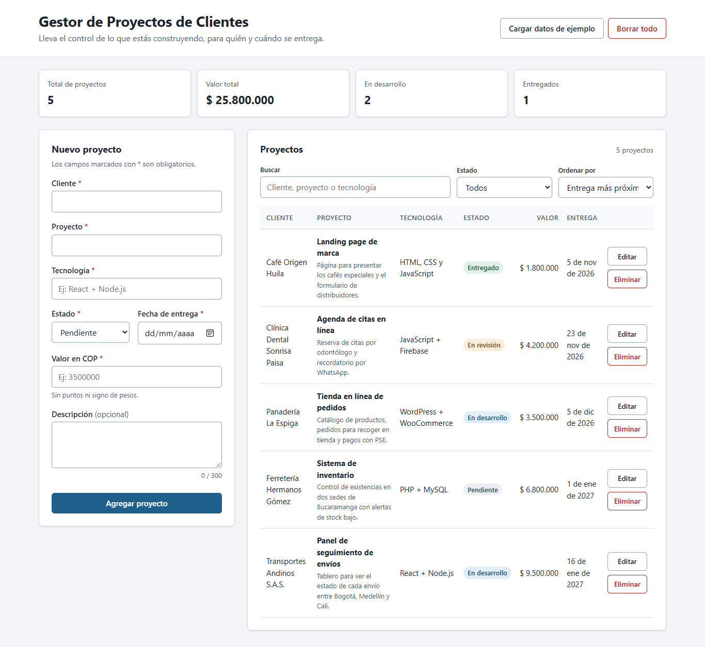
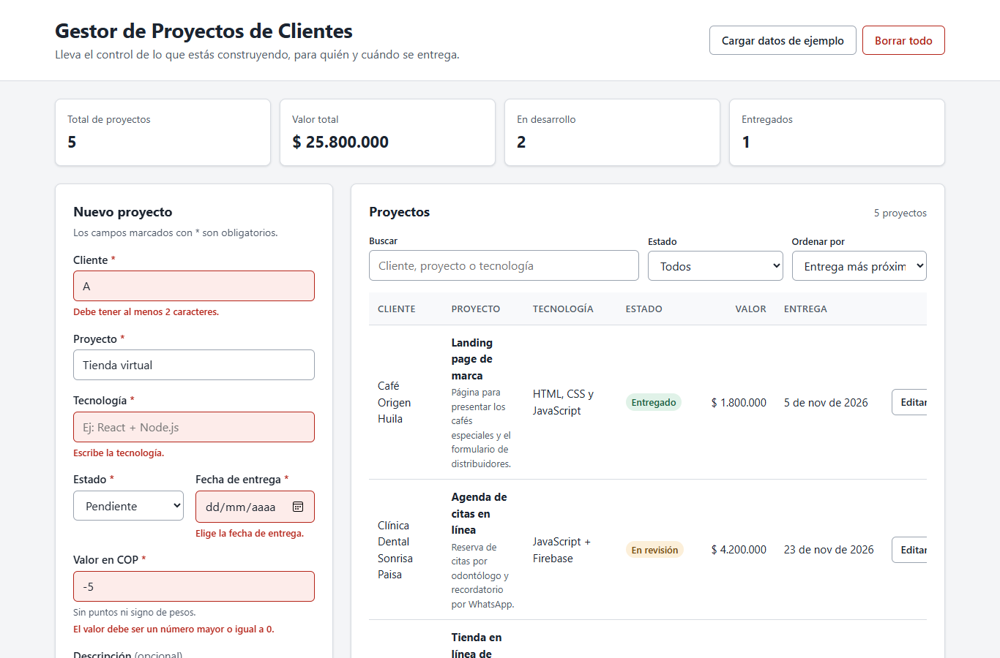
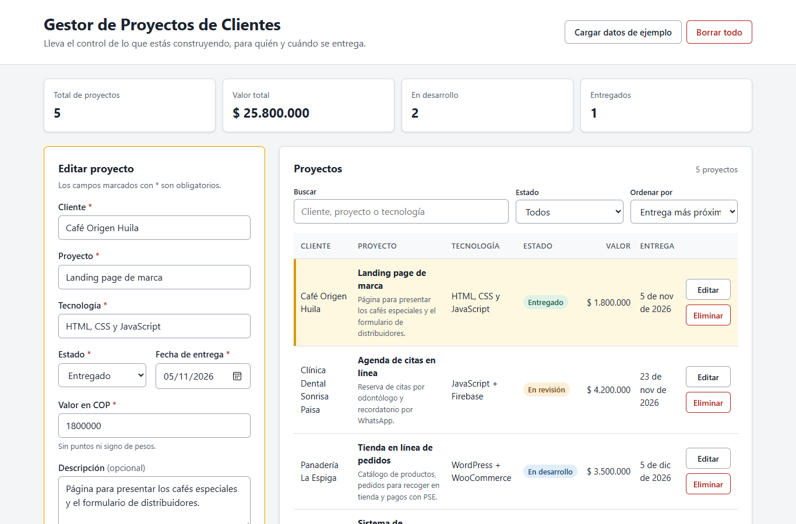
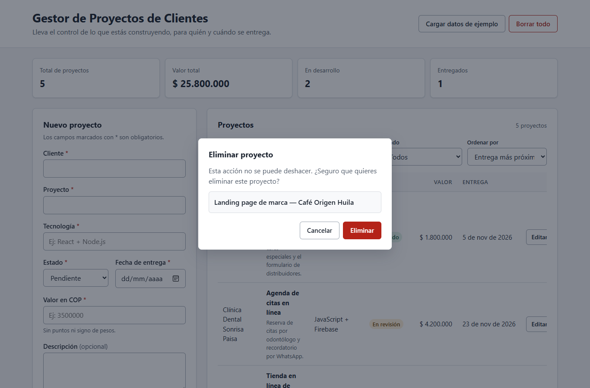
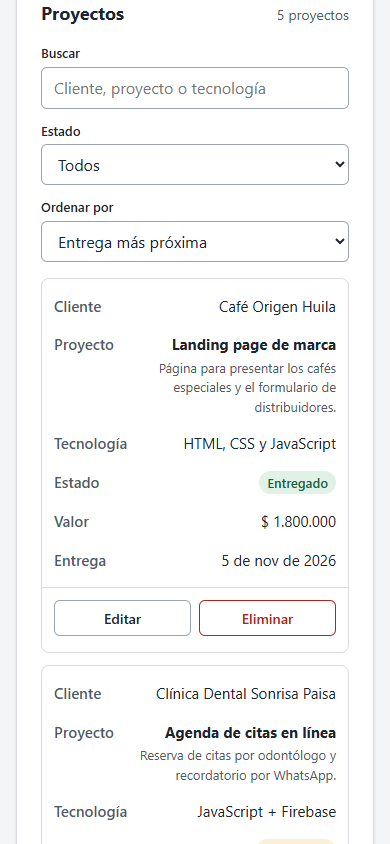

# Gestor de Proyectos de Clientes

## Descripción breve

Aplicación web para que un desarrollador independiente lleve el control de los proyectos que hace para sus clientes: quién es el cliente, qué se está construyendo, con qué tecnología, en qué estado va, cuánto vale y cuándo se entrega. Permite crear, ver, editar y eliminar proyectos (CRUD), buscar y filtrar, y ver un resumen rápido. Los datos se guardan en el navegador con `localStorage`, así que no necesita servidor ni base de datos.

**Repositorio:** https://github.com/Esteban5675/crud_ia_fet



## Tecnologías utilizadas

- **HTML5** semántico (`<form>`, `<table>`, `<dialog>`, `aria-*`).
- **CSS3** con variables (custom properties), Grid, Flexbox y media queries.
- **JavaScript vanilla** (ES2020+), sin frameworks, librerías, npm ni proceso de build.
- **localStorage** para la persistencia, con la clave `proyectos_clientes_v1`.
- **Intl.NumberFormat** e **Intl.DateTimeFormat** para mostrar pesos colombianos y fechas en formato `es-CO`.

## Estructura del proyecto

```
.
├── index.html              # Estructura de la página
├── css/
│   └── estilos.css         # Estilos, variables de color y espaciado, responsive
├── js/
│   ├── almacenamiento.js   # Solo lee y escribe en localStorage
│   ├── proyectos.js        # Lógica del CRUD: crear, listar, actualizar, eliminar, validar (sin DOM)
│   ├── interfaz.js         # Todo lo que toca el DOM: tabla, formulario, diálogo, notificaciones
│   └── main.js             # Arranque de la app y manejo de eventos
├── docs/
│   └── capturas/           # Capturas de pantalla para este README
├── README.md
└── .gitignore
```

Cada archivo expone un único objeto (`Almacenamiento`, `Proyectos`, `Interfaz`, `App`) para no dejar variables globales sueltas. Se usan scripts clásicos (no ES modules) cargados en orden, porque los módulos no funcionan al abrir el archivo directamente con `file://`.

## Instrucciones para ejecutar

**Opción 1 (la más simple):** abrir el archivo `index.html` con doble clic, o arrastrarlo a cualquier navegador moderno (Chrome, Edge, Firefox, Safari). No hay que instalar nada.

**Opción 2 (con servidor local):**

- Con Node.js instalado, desde la carpeta del proyecto:
  ```bash
  npx serve
  ```
  y abrir la dirección que muestra la terminal (normalmente `http://localhost:3000`).
- O en Visual Studio Code, con la extensión **Live Server**: clic derecho sobre `index.html` → *Open with Live Server*.

> Los datos se guardan por navegador y por origen: lo que guardes abriendo el archivo directamente no aparecerá si luego lo abres con `npx serve`, y viceversa.

## Funcionalidades

### Create (crear)

Formulario con cliente, proyecto, tecnología, estado, valor en COP, fecha de entrega y descripción opcional. Valida cada campo y muestra el mensaje de error debajo del campo (sin `alert`), con el foco en el primer error. Al guardar, el formulario se limpia y aparece una notificación.

- Validación: `Proyectos.validar()` y `Proyectos.validarTexto()` en `js/proyectos.js`.
- Creación del registro (id, fechas ISO): `Proyectos.crear()` en `js/proyectos.js`.
- Envío del formulario: `App.manejarEnvio()` y `App.guardarNuevo()` en `js/main.js`.
- Mensajes de error y toast: `Interfaz.mostrarErrores()` e `Interfaz.notificar()` en `js/interfaz.js`.

### Read (leer)

Tabla con todos los proyectos: el estado se muestra como etiqueta de color, el valor en pesos colombianos sin decimales y la fecha de entrega sin el desfase de zona horaria. En el celular cada fila se convierte en una tarjeta. Si no hay proyectos, o si la búsqueda no encuentra nada, aparece un mensaje amigable. Incluye búsqueda en tiempo real, filtro por estado, orden por fecha o valor y tarjetas de resumen.

- Lista filtrada y ordenada: `Proyectos.listar()`, `Proyectos.ordenar()` y `Proyectos.resumen()` en `js/proyectos.js`.
- Pintar la tabla: `Interfaz.renderTabla()` y `Interfaz.crearFila()` en `js/interfaz.js`.
- Formatos: `Interfaz.formatearValor()` e `Interfaz.formatearFecha()` en `js/interfaz.js`.
- Volver a pintar tras cada cambio: `App.refrescar()` en `js/main.js`.

### Update (actualizar)

El botón **Editar** carga el proyecto en el mismo formulario, el botón principal cambia a **Guardar cambios**, aparece **Cancelar edición** y la fila que se edita queda resaltada. Se conservan el `id` y `creadoEn`, y se actualiza `actualizadoEn`.

- Actualización del registro: `Proyectos.actualizar()` en `js/proyectos.js`.
- Entrar y salir del modo edición: `App.iniciarEdicion()`, `App.guardarEdicion()` y `App.cancelarEdicion()` en `js/main.js`.
- Cambios visuales: `Interfaz.activarModoEdicion()` e `Interfaz.desactivarModoEdicion()` en `js/interfaz.js`.

### Delete (eliminar)

El botón **Eliminar** abre un `<dialog>` de confirmación con el nombre del proyecto y del cliente. Solo se borra si se confirma; el foco empieza en **Cancelar** para evitar borrados accidentales. Si se elimina el proyecto que se estaba editando, el formulario se reinicia. También existe **Borrar todo**, con su propia confirmación.

- Borrado del registro: `Proyectos.eliminar()` y `Proyectos.borrarTodo()` en `js/proyectos.js`.
- Flujo de confirmación: `App.confirmarEliminacion()` y `App.borrarTodo()` en `js/main.js`.
- Diálogo accesible: `Interfaz.confirmar()` e `Interfaz.restaurarFoco()` en `js/interfaz.js`.

### Otros

- **Cargar datos de ejemplo:** agrega 5 proyectos de clientes colombianos con fechas calculadas desde hoy. Si ya hay datos, pide confirmación antes (`Proyectos.cargarEjemplos()`, `App.cargarEjemplos()`).
- **Datos dañados:** si `localStorage` tiene JSON corrupto, un formato inesperado o el navegador lo bloquea, la app arranca vacía y lo avisa en vez de romperse (`Almacenamiento.cargar()`, `Proyectos.inicializar()`).
- **Seguridad:** nada de lo que escribe el usuario se inserta con `innerHTML`; todo se construye con `createElement` y `textContent` para evitar XSS.
- **Accesibilidad:** labels asociados a cada campo, `aria-invalid` y `aria-describedby` en los errores, `aria-live` en las notificaciones, foco controlado en el diálogo, enlace para saltar al contenido, foco visible y respeto por `prefers-reduced-motion`.

## Capturas de pantalla

| Vista | Captura |
|---|---|
| Listado de proyectos |  |
| Crear proyecto (con validación) |  |
| Editar proyecto |  |
| Confirmación de eliminación |  |
| Vista en móvil |  |

## Uso de IA y lista de prompts

Usé un asistente de IA (Claude Code) como apoyo para generar la base del proyecto, revisar la lógica y probarla. Cada prompt queda registrado aquí con el mismo formato, para que se vea qué pedí, para qué y qué cambió en el código.

### Prompt 1

- **Texto del prompt (resumido pero fiel):** "Crea un 'Gestor de Proyectos de Clientes' para un desarrollador independiente con HTML, CSS y JavaScript vanilla, sin frameworks ni npm, guardando en localStorage con la clave `proyectos_clientes_v1` y que funcione abriendo `index.html` sin servidor (scripts clásicos, no ES modules). Estructura: `index.html`, `css/estilos.css`, `js/almacenamiento.js`, `js/proyectos.js`, `js/interfaz.js`, `js/main.js`, README, `.gitignore` y `docs/capturas`. Cada proyecto tiene id, cliente, proyecto, tecnología, estado, valor en COP, fecha de entrega, descripción, creadoEn y actualizadoEn. CRUD completo: formulario con validación bajo cada campo y toast, tabla con estado de color, COP con Intl y fecha sin desfase, edición en el mismo formulario con la fila resaltada, eliminación con `<dialog>`. Extras: búsqueda en tiempo real, filtro por estado, ordenamiento, tarjetas de resumen, datos de ejemplo y borrar todo, y que no se rompa con datos corruptos. Código limpio con un objeto por archivo, comentarios en español, sin innerHTML con datos del usuario, accesible y responsive. Haz git init con commits pequeños en español, crea este README con sus secciones, verifica con `node --check` y prueba la lógica."
- **Qué se pidió:** construir la aplicación completa desde cero, con su repositorio Git, documentación y pruebas.
- **Para qué:** tener una base funcional y bien organizada del CRUD, con historial de commits que muestre cómo se fue armando paso a paso.
- **Qué cambió en el código:** se crearon todos los archivos del proyecto. Commits: "Estructura base HTML y CSS", "Create: formulario con validación", "Read: listado en tabla", "Update: edición de registros", "Delete: confirmación con dialog", "Búsqueda, filtro y ordenamiento", "Datos de ejemplo y borrar todo" y "README con documentación y registro de prompts". Se verificó la sintaxis con `node --check` y se probó la lógica y el flujo completo con scripts temporales (Node + jsdom) que se borraron al terminar.

### Prompt 2

- **Texto del prompt (resumido pero fiel):** "En el diálogo de confirmación, el recuadro con el nombre del proyecto tiene un borde rojo a la izquierda que se ve muy agresivo; déjalo con un borde neutro."
- **Qué se pidió:** un ajuste visual (refactor de estilos) del diálogo de eliminación.
- **Para qué:** que el detalle del proyecto se lea como información y no como un error; el rojo queda solo para el botón **Eliminar**, que es la acción peligrosa.
- **Qué cambió en el código:** en `css/estilos.css`, `.dialogo__detalle` pasó de `border-left: 4px solid var(--color-peligro)` a `border: 1px solid var(--color-borde)`. Commit: "Diálogo: borde neutro en el detalle del proyecto".

### Prompt 3

- **Texto del prompt (resumido pero fiel):** "Encárgate de la parte 2 de la entrega (repositorio de GitHub): que el README tenga nombre del proyecto, descripción breve, tecnologías utilizadas, instrucciones para ejecutar, capturas de pantalla y la lista de prompts con su explicación, y súbelo a https://github.com/Esteban5675/crud_ia_fet.git."
- **Qué se pidió:** dejar el repositorio listo para entregar y publicarlo en GitHub.
- **Para qué:** cumplir con los requisitos del repositorio de la entrega.
- **Qué cambió en el código:** se tomaron las 5 capturas de `docs/capturas/` con la app corriendo (listado con datos de ejemplo, validación al crear, modo edición, diálogo de eliminación y vista móvil), se completó este registro de prompts, se agregó el enlace al repositorio y se hizo `push` a GitHub. El código de la app no cambió.

### Prompt 4

- **Texto del prompt (resumido pero fiel):** "Sí, elimina `promts.md` del repositorio."
- **Qué se pidió:** quitar del repositorio el archivo `promts.md`, que era un borrador de notas.
- **Para qué:** que la lista oficial de prompts esté en un solo lugar (este README) y el repositorio quede limpio.
- **Qué cambió en el código:** se eliminó `promts.md` (commit "Eliminar promts.md (los prompts están en el README)") y se registró este prompt. El código de la app no cambió.

<!--
Plantilla para los siguientes prompts (copiar y llenar):

### Prompt N

- **Texto del prompt (resumido pero fiel):** ...
- **Qué se pidió:** ...
- **Para qué:** ...
- **Qué cambió en el código:** ...
-->

## Pruebas manuales

Checklist para revisar la app en el navegador:

**Create**
- [ ] Enviar el formulario vacío muestra un mensaje debajo de cada campo obligatorio y el foco va al primero.
- [ ] Un cliente de 1 letra, un valor negativo o una fecha vacía muestran su error.
- [ ] Al escribir en un campo con error, el mensaje desaparece.
- [ ] Al guardar un proyecto válido, el formulario se limpia, aparece el toast y el proyecto sale en la tabla.
- [ ] Escribir `<b>hola</b>` o `` como cliente se muestra como texto, sin ejecutar nada.

**Read**
- [ ] Sin proyectos aparece el mensaje de "Todavía no tienes proyectos registrados".
- [ ] El valor se ve como `$ 3.500.000` y la fecha de entrega es el mismo día elegido (no el anterior).
- [ ] Cada estado tiene su color.
- [ ] La búsqueda filtra mientras se escribe, sin importar tildes ni mayúsculas ("bogota" encuentra "Bogotá").
- [ ] Una búsqueda sin resultados muestra "Ningún proyecto coincide con la búsqueda".
- [ ] El filtro por estado y los cuatro órdenes funcionan.
- [ ] Las tarjetas de resumen cuadran con los datos.

**Update**
- [ ] "Editar" llena el formulario, el botón dice "Guardar cambios", aparece "Cancelar edición" y la fila se resalta.
- [ ] Guardar con un dato inválido muestra el error y no cambia nada.
- [ ] Guardar cambios actualiza la fila y el formulario vuelve a "Agregar proyecto".
- [ ] "Cancelar edición" limpia el formulario y quita el resaltado.

**Delete**
- [ ] "Eliminar" abre el diálogo con el nombre del proyecto y el foco en "Cancelar".
- [ ] "Cancelar" o la tecla Escape cierran el diálogo sin borrar.
- [ ] "Eliminar" borra el proyecto y muestra un toast.
- [ ] Eliminar el proyecto que se está editando deja el formulario en modo "Nuevo proyecto".
- [ ] "Borrar todo" pide confirmación y deja la lista vacía.

**Datos y persistencia**
- [ ] Al recargar la página, los proyectos siguen ahí.
- [ ] "Cargar datos de ejemplo" con la lista vacía agrega 5 proyectos; con datos, pide confirmación primero.
- [ ] Si en las herramientas del navegador se cambia `proyectos_clientes_v1` por texto inválido y se recarga, la app arranca vacía y avisa.

**Accesibilidad y diseño**
- [ ] Todo se puede usar solo con teclado (Tab, Shift+Tab, Enter, Escape) y el foco siempre se ve.
- [ ] En escritorio el formulario queda a la izquierda y la tabla a la derecha; en el celular se apilan y la tabla se ve como tarjetas.

## Aprendizajes y decisiones

- **Separar responsabilidades en cuatro archivos.** `proyectos.js` no toca el DOM ni `localStorage`, así que la lógica se pudo probar en Node sin navegador. Si algún día cambio `localStorage` por una API, solo tendría que modificar `almacenamiento.js`.
- **Scripts clásicos en vez de módulos.** Los ES modules no cargan con `file://`, y uno de los requisitos era abrir `index.html` directamente. Para no ensuciar el ámbito global, cada archivo expone un solo objeto.
- **Fechas sin desfase.** `new Date('2025-03-10')` se interpreta en UTC y en Colombia (UTC-5) se muestra como el 9 de marzo. Por eso la fecha se arma con sus partes (`new Date(año, mes - 1, día)`), que la deja en hora local.
- **Nada de `innerHTML` con datos del usuario.** Todo se construye con `createElement` y `textContent` para evitar XSS.
- **Un solo `<dialog>` reutilizable.** `Interfaz.confirmar()` devuelve una promesa, así que se usa con `await` como si fuera `confirm()`, pero con estilo propio y accesible. Sirve para eliminar uno, borrar todo y cargar ejemplos.
- **Delegación de eventos en la tabla.** Como las filas se vuelven a crear en cada cambio, un solo listener en el `<tbody>` evita tener que volver a asignar eventos a cada botón.
- **No confiar en lo que hay guardado.** Los registros de `localStorage` se validan al arrancar, porque cualquiera puede editarlos desde las herramientas del navegador.
- **Búsqueda sin tildes.** Se normaliza el texto con `normalize('NFD')` para que "revision" encuentre "Revisión".
